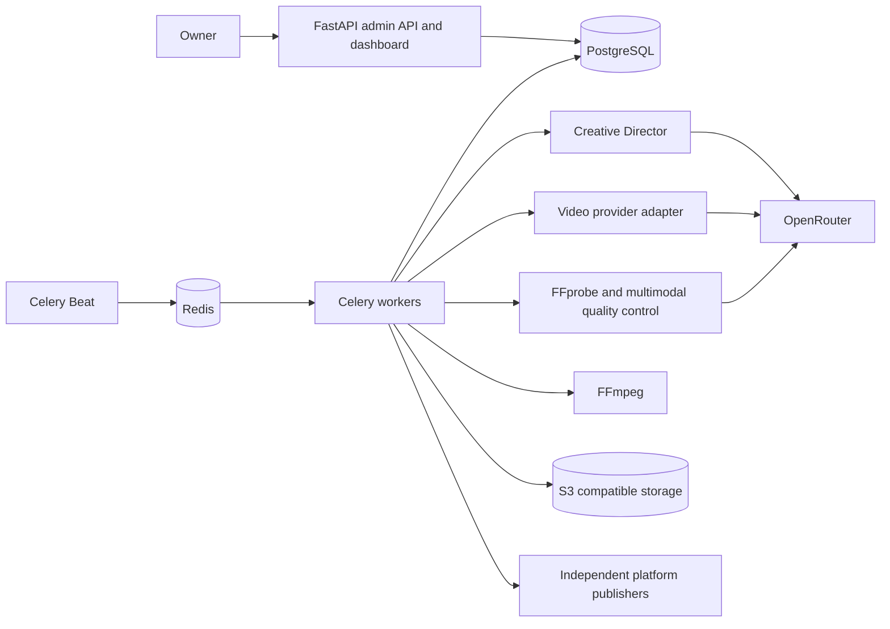

# The Satisfying Universe — architecture

Decision date: 2026-11-04. Tagline: Beautiful things. Perfect moments.

## Product and launch boundary

Produce two original portrait videos daily, 15–20 seconds each. Target master:
1080×1920, square pixels, H.264/yuv420p MP4, 30 fps, faststart; AAC only when
appropriate audio exists. Preserve original files and native frame rates in metadata.
No narration, burned-in branding, or artificial extension of weak footage.

Current owner direction: launch on **YouTube only**, on the TechnoInno channel under
admin.technoinno@gmail.com. Target two originals and two YouTube Shorts daily.
Instagram and TikTok are paused and are not launch dependencies. Keep platform adapters
separate for a possible later expansion; no credentials, account setup or publication
is requested for the paused platforms. TikTok's previously researched policy constraints
remain documented in [research](docs/RESEARCH.md).

The studio host is https://studio.technoinno.live, resolved to owner-authorized VPS
203.161.61.3. SSH inspection verified fresh Ubuntu 24.04.5 with one CPU/about 1 GB RAM
and only SSH listening. Root package/service changes require explicit approval following
automatic review rejection. Nothing has been installed or deployed. Do not rename the
channel or change main-domain DNS. Owner-login and OAuth code are ready locally.

## Services

Python 3.13, FastAPI, SQLAlchemy/Alembic, PostgreSQL 17, Redis 7, Celery 5,
FFmpeg, Docker Compose. Use one repository and one deployable application image,
with API, worker, and Beat as distinct processes. No OpenClaw, n8n, or external
orchestrator. S3 is a pluggable storage dependency; local directories support development.
Docker services must bind locally initially; production HTTPS terminates at a reverse proxy.

## Durable execution design

PostgreSQL owns jobs, retries, remote IDs, spend reservations, and publication state.
Celery transports work; it is never the only record that a task exists.
Two daily slots use unique keys `daily:YYYY-MM-DD:1|2` in Africa/Casablanca.
Beat periodically rescans durable queued jobs, so a broker outage cannot discard a request.
Workers claim short row-locked leases with ownership tokens. Expired safe local work may be
reclaimed; paid submissions and uploads with uncertain outcomes enter reconciliation.
Persist submit intent before external calls, then persist the returned remote ID.
Resume polling an existing remote ID after restart. No automatic resubmission when a
timeout leaves acceptance unknown. Do not claim exactly-once remote delivery without a
provider guarantee. Publication uniqueness is `(video, social account)`.

Proposed full pipeline states: planned → creative → generation_submitting →
generation_polling → downloaded → technical_check → visual_check → postproduction →
approved → publishing → complete. Explicit branches: blocked_budget,
reconciliation_required, rejected, failed, awaiting_authorization.

Milestone 1 implements only queued → preflight → awaiting_configuration, with
bounded retry/failure and expired-lease recovery. That honest stopping point must
not be counted as a produced video. No live provider or publisher is wired yet.

## Financial invariant

Every paid request needs explicit owner authorization, a verified model capability
snapshot, and a conservative upper-bound quote. Reserve before submitting. Serialize
all reservations on a database guard row; use decimal USD. Both rolling day and
calendar-month exposure include unresolved reservations from previous periods, plus
settled costs in the current period. Unknown cost retains the hold. Same operation
key returns the same reservation; changed inputs conflict. Settlement is immutable;
overruns create a persistent global hold before another request can start.
Provider-level key limits complement application limits. Stopping notifications require
a visible persistent alert; external email/chat alerts need a configured, authorized channel.

## Provider and agent boundaries

Creative Director returns a validated `CreativeBrief` with novelty history and versioned
prompts. VideoProducer consumes a clip plan, validates the live catalogue, submits once,
polls with backoff, downloads originals, and records quoted/actual usage. QualityController
combines a decode check, technical measurements, ordered frame sequences and video-aware
review; sparse frames alone cannot establish motion quality. Score weights are 25/20/20/20/15;
technical failure always vetoes the 80/100 publication threshold. Maximum two full generation
attempts per concept, not two extra retries per clip. A multi-clip attempt reserves all clips.

Model default is unset until a paid three-family benchmark and owner review of outputs.
Prefer native 1080p; mark 720p outputs and any upscale explicitly. Do not assume per-model
resolution, duration, aspect ratio, audio, seed, watermark, or idempotency support.

## Data and storage

Initial migration creates concepts, prompts, video_generations, videos, quality_checks,
social_accounts, publications, analytics, model_usage, production_jobs, system_settings,
and operational budget/alert tables. Secrets are references in social_accounts, never raw tokens.
Quality and publication records link back to immutable original/prompt/model evidence.
Unavailable metrics are absent/null with a reason, never zero estimates.

Working directories: ideas/, prompts/, generated/, approved/, rejected/, publications/,
analytics/. Production objects use private buckets, immutable keys and checksums.
Only vetted final media gets time-limited fetch URLs for publishing. Never attach
OpenRouter credentials to an arbitrary returned URL; validate origin before authenticated download.

## Security and operations

Admin bearer token is required even locally. Fail closed if absent; disable public API docs;
no credentials in URLs or logs. Future dashboard login should use secure server sessions,
CSRF protection, and owner identity. OAuth requires state validation, exact redirects,
encrypted refresh-token storage, scope minimization, revocation, and account-ID checks.
Never connect personal channels. AI disclosure is platform metadata, even when no caption
or visible watermark is wanted. Do not remove provenance watermarks.

Back up PostgreSQL and object files independently, encrypt off-host copies, and test restore
before launch. Containers run as non-root; PostgreSQL/Redis have no host ports in Compose.
Launch gates include Compose smoke tests, backup restoration, spend-concurrency tests,
restart reconciliation, approval evidence, private upload tests, and reviewed samples.
